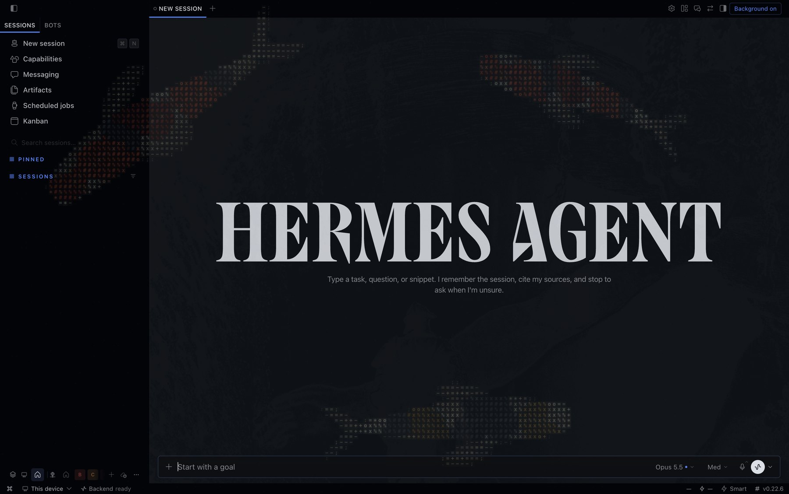
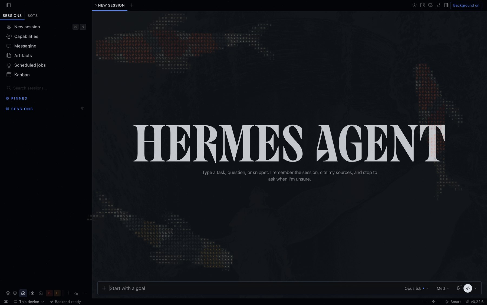
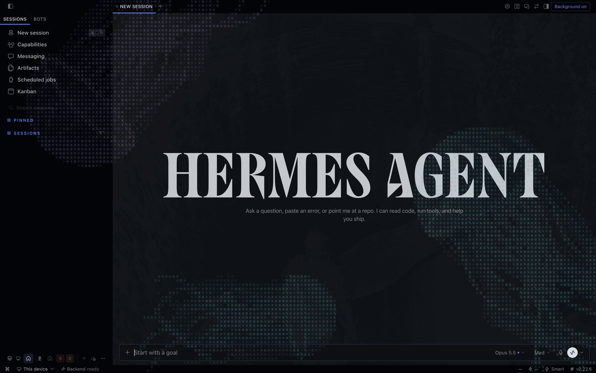
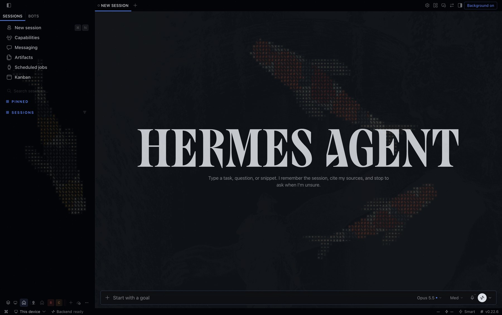
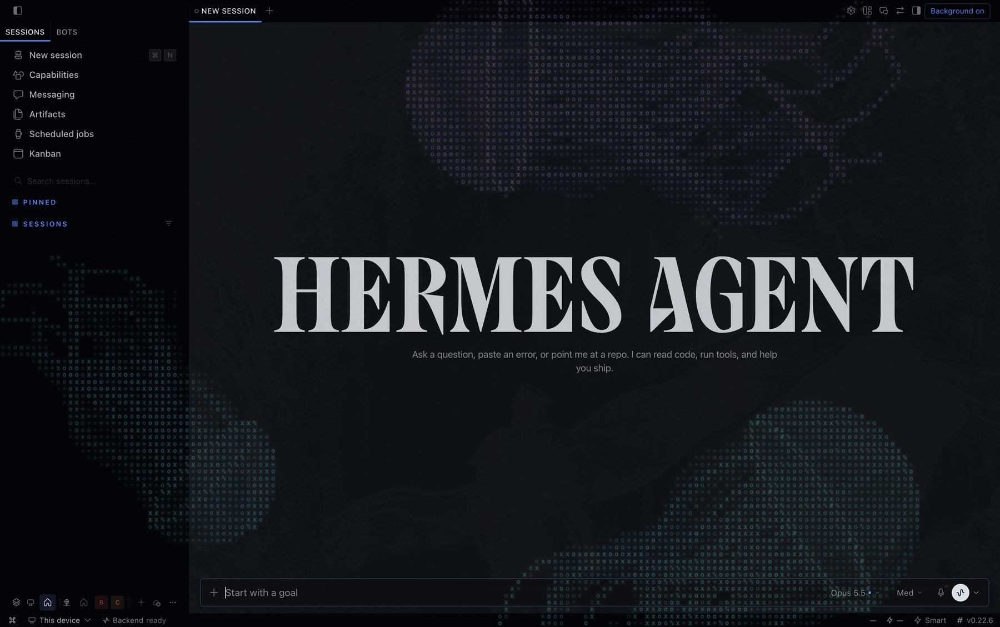
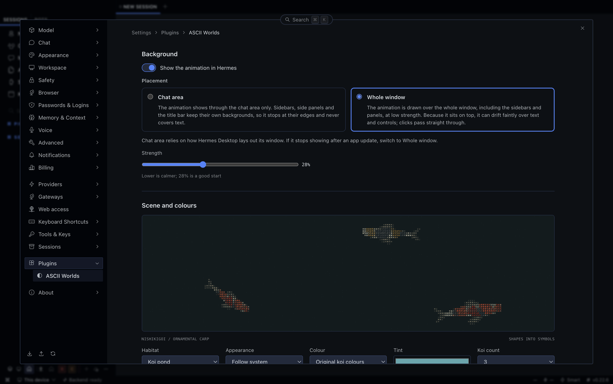
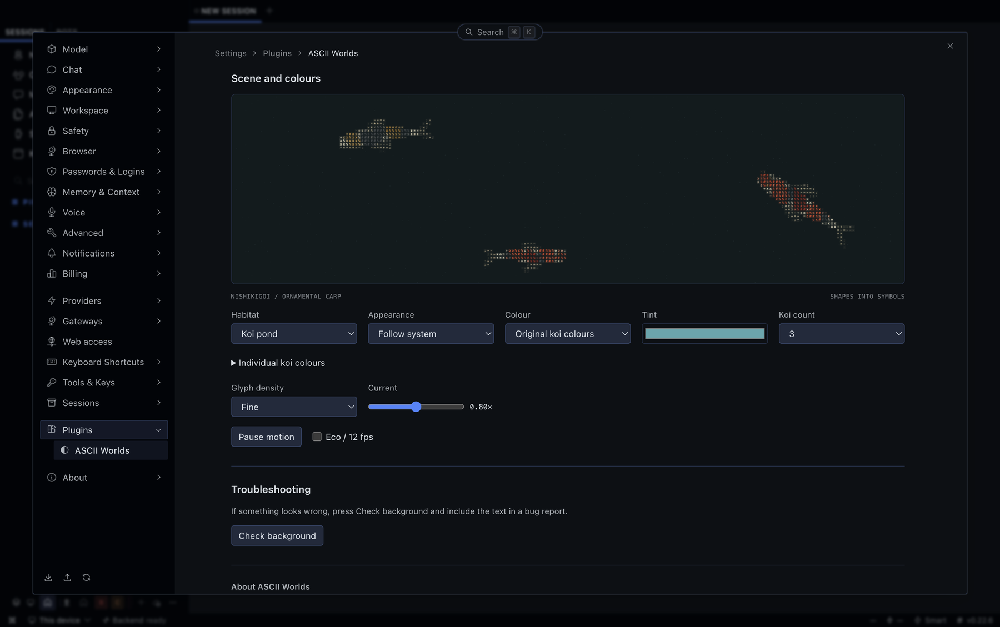

# ASCII Worlds


A tiny aquarium for Hermes Desktop, drawn entirely out of text characters. Koi and jellyfish swim across your window, turn around, drift past each other and never really repeat. Flip one switch and they are there behind your work. Flip it again and they are gone.



*Koi drifting across Hermes Desktop. Every screenshot here is from Hermes Desktop 0.22.6.*

Nothing is downloaded and nothing is pre-rendered. Every fish is built from shapes and glyphs on a canvas inside your own app, so it works offline and it is a single readable file.

## What you can do with it

- **Pick a habitat.** A koi pond or a jellyfish drift. Choose anywhere from 0 to 10 creatures.
- **Colour them your way.** Start from the original koi patterns or one of the Jewel, Sunset, Pastel and Forest palettes, or give every single fish and jellyfish its own colour. Koi get a multi-tone pattern built around the colour you choose, not a flat tint.
- **Make it fit your setup.** Light, dark or follow-the-system, speed, glyph density, pause, and an eco mode that caps the frame rate if you want your laptop to stay cool.
<!-- chat-area:begin -->
- **Put it where you like.** Show it through the chat area only, or across the whole window, sidebars included.
<!-- chat-area:end -->
<!-- catalog: - **See it across the whole window.** The animation sits over everything, sidebars included, at a strength you choose. -->
- **Stay in control.** It respects your reduced-motion setting, pauses when the window is hidden, and removes everything it added the moment you turn it off.

Everything lives in one place, **Settings -> Plugins -> ASCII Worlds**, with a quick on/off button in the title bar.

## Screenshots

| Koi pond | Jellyfish drift |
|---|---|
|  |  |
|  |  |

And the settings page, where all of it is controlled:





## Install

Desktop plugins live on the computer that runs the Desktop app, not on a remote gateway.

1. Download `ascii-worlds-<version>-plugin.zip` from the [latest release](https://github.com/dudicslevente/hermes-ascii-worlds/releases/latest) and unzip it. Inside you will find a folder called `ascii-worlds`.
2. Copy that folder into `~/.hermes/desktop-plugins/`, so the plugin ends up at `~/.hermes/desktop-plugins/ascii-worlds/plugin.js`. The folder name has to stay `ascii-worlds`. If you use `HERMES_HOME` or a named profile, use the `desktop-plugins/` folder inside that Hermes home instead.
3. Open the command palette and run **Reload desktop plugins**. If ASCII Worlds does not show up, go to **Capabilities -> Plugins** and make sure it is switched on.
4. Replacing an older copy? Quit and reopen Hermes Desktop once, so a stale copy cannot keep running.

Prefer the command line? From a clone of this repository:

```sh
mkdir -p ~/.hermes/desktop-plugins/ascii-worlds
cp desktop/plugin.js ~/.hermes/desktop-plugins/ascii-worlds/plugin.js
```

To remove it, switch it off in Capabilities -> Plugins and delete the folder.

You need Hermes Desktop 0.21.6 or newer, which is the first release with plugin settings pages and the title-bar slot. I have only tried it by hand on Hermes Desktop 0.22.6 on macOS, so Windows, Linux and other versions are untested. The Desktop plugin SDK is documented [here](https://hermes-agent.nousresearch.com/docs/developer-guide/desktop-plugin-sdk).

## Using it

1. Open **Settings -> Plugins -> ASCII Worlds**.
2. Switch on **Show the animation in Hermes**.
3. Choose a habitat, how many creatures you want and what colour they are under **Scene and colours**.

You can also toggle the animation any time with the **Background** button in the title bar, or from the command palette with **ASCII Worlds: toggle background** and **ASCII Worlds: open settings**.

The **Strength** slider controls how bold it is. 28 percent is a good place to start.

<!-- chat-area:begin -->
### Chat area or whole window?

| | Chat area | Whole window |
|---|---|---|
| Where it shows | Through the chat area only | Over the whole window, sidebars and panels included |
| Sidebars and title bar | Keep their own backgrounds, so the animation stops at their edges | The animation is drawn across them |
| Text and controls | Never covered | Because it sits on top, glyphs can drift faintly over text and controls; clicks pass straight through |
| How it works | Makes the chat's background layers transparent while it is on | Adds one extra layer above the app and changes nothing else |
| Risk | Relies on how Hermes Desktop lays out its window, so an app update may need a switch to Whole window | None; it does not depend on the window layout |
<!-- chat-area:end -->
<!-- catalog:
The animation is drawn over the whole window, sidebars included. Because it sits on top, glyphs can drift faintly over text and controls, and clicks pass straight through. It adds one extra layer above the app and changes nothing else, so it does not depend on how Hermes Desktop lays out its window.
-->

## If something looks off

<!-- chat-area:begin -->
- **I turned it on and see nothing in my chat.** Open Settings -> Plugins -> ASCII Worlds, press **Check background** and read the report. The first lines show the running version and the placement, and any line saying an element is still painting a colour tells you what is hiding the animation. The quick fix is to switch **Placement** to **Whole window**.
<!-- chat-area:end -->
<!-- catalog: - **I turned it on and see nothing.** Open Settings -> Plugins -> ASCII Worlds, press **Check background** and read the report. It shows the running version and whether the animation layer exists, is on top and has painted anything. Then open an issue with that text. -->
- **It looks too busy.** Lower **Strength**, pick the Monochrome colour, or use fewer creatures.
- **My computer feels warm.** Switch on **Eco**, pause motion, or use fewer jellyfish. They cost far more than koi. The background draws at a capped 12 frames per second with coarse glyphs, while the preview in the settings page is more detailed and heavier.
- **The plugin is not in Settings.** Check that it is enabled in Capabilities -> Plugins, then run **Reload desktop plugins**. On a Desktop version without plugin settings pages, the title-bar button and the command palette entries still work.

If you report a bug, please include the text from **Check background** and your Hermes Desktop version. It saves a lot of guessing.

## Privacy and security

- No network access, no telemetry, no analytics, no external fonts or images.
- Your preferences are saved in the plugin's own local storage on your machine and never leave it.
- Like every disk plugin, it runs inside the Desktop app with the app's authority. It is one readable file. It draws on a canvas, and while the animation is on it adds one layer, one stylesheet and one attribute to the page, then removes them when you turn it off. The exact pieces are listed in [How Background works](docs/HOW-BACKGROUND-WORKS.md).
- The switch in the settings, the title-bar button and the command palette entry each turn it off and put the page back as it was.

## Good to know

<!-- chat-area:begin -->
- **Chat area does not show behind sidebars.** Sidebars and side panels paint their own backgrounds, and the plugin only clears the chat area. Use Whole window if you want the animation across everything, at the price of it floating over text.
<!-- chat-area:end -->
<!-- chat-area:begin -->
- **Chat area relies on how Hermes Desktop is built.** It uses the documented chat hook and a few app theme colour variables to keep the chat colour unchanged. A Desktop update could change them. Whole window does not depend on them.
<!-- chat-area:end -->
- I have only checked it by hand on one Hermes Desktop version on macOS. Windows and Linux are untested.
- Lots of large, finely detailed creatures cost real CPU, jellyfish far more than koi. The background layer is deliberately coarse and capped, but your hardware still matters. That is why the maximum is 10 of each.
- The art is original and procedural. It is an independent take on the glyph-aquarium look, not a copy of any product.

## More designs are coming, and you can help

Koi and jellyfish are just the start. I plan to add new designs over time, and I would love to see yours. Habitats are small, self-contained pieces: a creature is a function that describes its shape and motion, and the engine turns that into glyphs. If you have an idea, say a seahorse, a school of tiny fish, falling leaves, a night sky, or a colour palette you think is missing, you are very welcome to:

- open an [issue](https://github.com/dudicslevente/hermes-ascii-worlds/issues) to suggest it, or to say you are working on it so we do not overlap,
- send a pull request. [CONTRIBUTING.md](CONTRIBUTING.md) explains how to set up, and [docs/ARCHITECTURE.md](docs/ARCHITECTURE.md) walks through how a new habitat is added, tested and shown in both the settings preview and the background.

Bug fixes, docs, accessibility improvements and testing on Windows and Linux are just as welcome as new art.

## Try it without installing

Open `demo.html` in a modern browser. It is a self-contained offline page. Add `?chat=1` to the address to see the background over a fake chat.

## For developers

It is one plain ES module with no build-time dependencies. The source is split into small files and bundled into `desktop/plugin.js` by a short script.

```sh
npm run build    # regenerate desktop/plugin.js and demo.html
npm run verify   # unit tests, then build
```

More in [Architecture](docs/ARCHITECTURE.md), [Development and testing](docs/DEVELOPMENT.md), [Will a Hermes update break this?](docs/COMPATIBILITY.md), [Catalog notes](docs/CATALOG.md) and the [changelog](CHANGELOG.md).

## Licence and credits

MIT. See [LICENSE](LICENSE) and [THIRD_PARTY_NOTICES.md](THIRD_PARTY_NOTICES.md). Inspired by public ASCII motion experiments and the principles of the MIT-licensed ascii-diorama project. No code from them is included.
