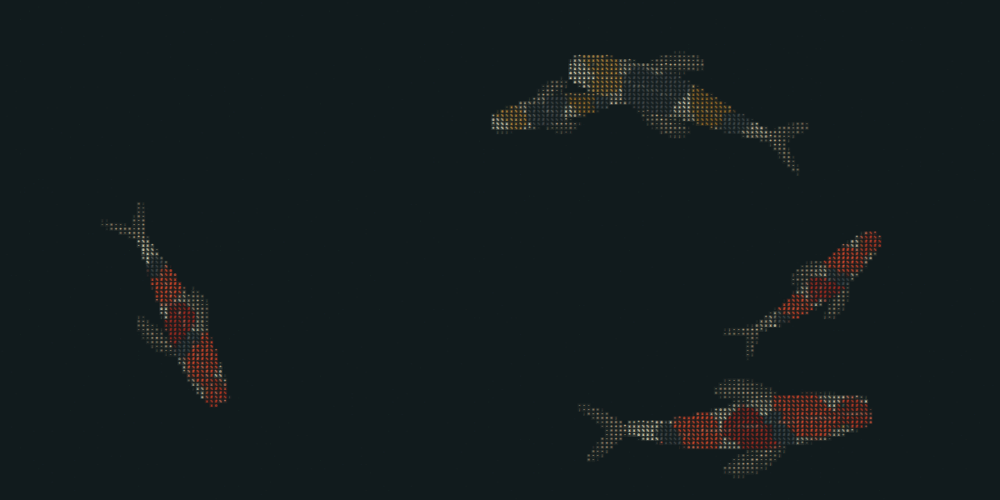
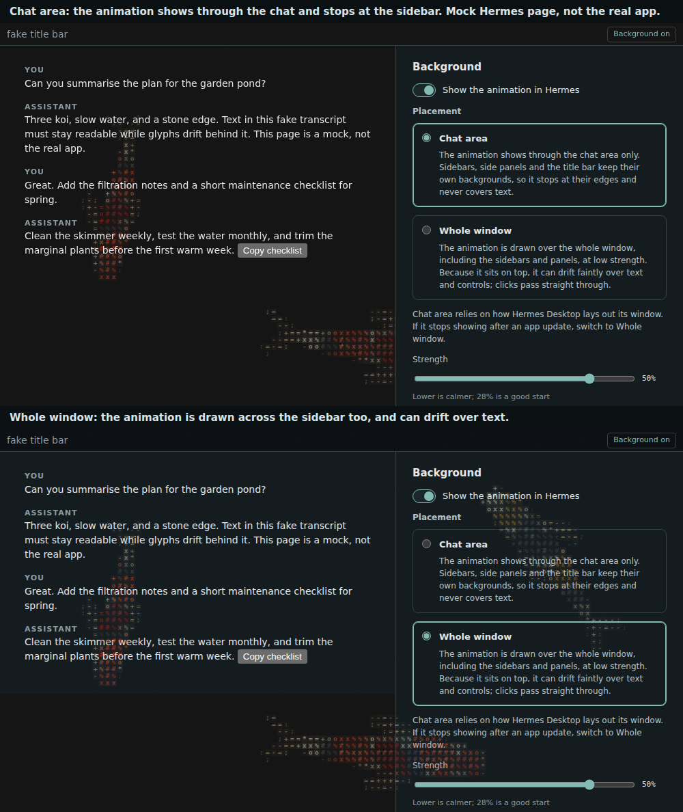
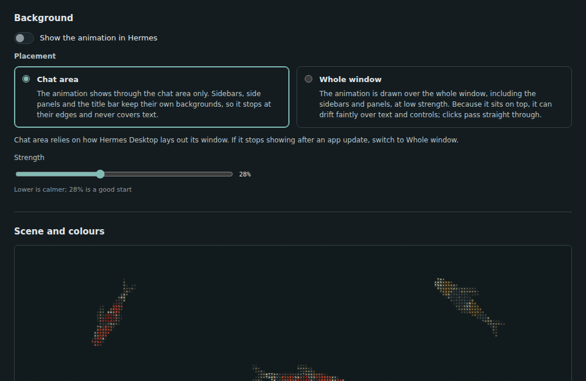

# ASCII Worlds



Living koi and jellyfish drawn entirely in text glyphs, for Hermes Desktop. Turn on **Show the animation in Hermes** and a slow, faint aquarium drifts through your chats.



*Chat area (top) and Whole window (bottom). The screenshots use a mock chat page and the plugin's own settings page, not a real conversation.*

Everything is drawn procedurally on a canvas in your own app: no images, no video files, no network access, nothing to download at runtime.

## Features

- Two habitats: a koi pond and a jellyfish drift, with shaded, articulated creatures that really travel across the screen and turn as they go. Choose 0 to 10 koi or 0 to 10 jellyfish.
- Background mode with two placements: **Chat area** (the animation shows through the chat and stops at the sidebars) or **Whole window** (drawn over everything, sidebars included).
- Colours: original koi patterns, Jewel, Sunset, Pastel and Forest koi palettes, natural, cyan, ember and monochrome tints, a custom tint, and individual colours for every koi and every jellyfish. Each koi gets a multi-tone pattern built from the colour you pick, not a flat tint.
- Light, dark or follow-the-system appearance, speed and glyph-density controls, pause, and an eco mode that caps the frame rate.
- Respects your reduced-motion setting, pauses when the window is hidden, and cleans up everything when you turn it off or disable the plugin.
- All controls live in **Settings -> Plugins -> ASCII Worlds**. A quick on/off button sits in the title bar.

## Requirements

- Hermes Desktop with desktop plugin support (the plugin SDK is documented at https://hermes-agent.nousresearch.com/docs/developer-guide/desktop-plugin-sdk).
- Hermes Desktop 0.21.6 or newer (the first release with plugin settings pages and the title-bar slot). Tested by hand on Hermes Desktop 0.22.6 on macOS; other versions and platforms have not been tried (see Known limitations).

## Install

Desktop plugins load from a folder on the computer that runs the Desktop app, not from a remote gateway.

1. Download this repository (or a release zip) and copy the `desktop` folder to `~/.hermes/desktop-plugins/ascii-worlds/`, so the file ends up at `~/.hermes/desktop-plugins/ascii-worlds/plugin.js`. The folder name must stay `ascii-worlds`. If you use `HERMES_HOME` or a named profile, use the `desktop-plugins/` folder inside that Hermes home.

   ```sh
   git clone https://github.com/dudicslevente/hermes-ascii-worlds.git
   mkdir -p ~/.hermes/desktop-plugins/ascii-worlds
   cp hermes-ascii-worlds/desktop/plugin.js ~/.hermes/desktop-plugins/ascii-worlds/plugin.js
   ```

2. Open the command palette and run **Reload desktop plugins**. If the plugin does not appear, open **Capabilities -> Plugins** and make sure **ASCII Worlds** is switched on.
3. If you are replacing an older copy, quit and reopen Hermes Desktop once so a stale copy cannot keep running.

Hermes Desktop can also install a plugin from a Git URL on the Plugins page; that route is built into the app but has not been tried with this plugin. If it is accepted into the Hermes plugin catalog, `hermes plugins install ascii-worlds` will work too. See [docs/CATALOG.md](docs/CATALOG.md).

To remove it, switch the plugin off in Capabilities -> Plugins and delete the folder.

## Use it

1. Open **Settings -> Plugins -> ASCII Worlds**.
2. Switch on **Show the animation in Hermes**.
3. Choose a placement (below), then pick a habitat, how many creatures you want and their colours under **Scene and colours**.

You can also toggle the animation any time with the **Background** button in the title bar, or with the command palette entries **ASCII Worlds: toggle background** and **ASCII Worlds: open settings**.

### Chat area or whole window

| | Chat area | Whole window |
|---|---|---|
| Where it shows | Through the chat area only | Over the whole window, including the sidebars and panels |
| Sidebars and title bar | Keep their own backgrounds, so the animation stops at their edges | The animation is drawn across them |
| Text and controls | Never covered | Because it sits on top, glyphs can drift faintly over text and controls; clicks pass straight through |
| How it works | Makes the chat's background layers transparent while it is on | Draws one extra layer above the app and changes nothing else |
| Risk | Relies on how Hermes Desktop lays out its window; may need a switch to Whole window after an app update | None; it does not depend on the window layout |

Use **Strength** to make it calmer or bolder. 28 percent is a good start.



## Troubleshooting

- **I turned it on and see nothing in my chat.** Open Settings -> Plugins -> ASCII Worlds, press **Check background**, and read the report. The first lines show the running version and the placement. Any line saying an element is still painting a colour names what is hiding the animation. As a quick fix, switch **Placement** to **Whole window**.
- **It looks too busy.** Lower **Strength**, choose the Monochrome colour, or reduce the jellyfish count.
- **My computer feels warm or the fans spin up.** Switch on **Eco**, pause motion, use fewer jellyfish, or choose the koi habitat with fewer fish. Background draws at a capped 12 frames per second with coarse glyphs; the preview in the settings page is more detailed and heavier.
- **The plugin is not in Settings.** Check that it is enabled in Capabilities -> Plugins, then run **Reload desktop plugins**. On a Desktop version without plugin settings pages, the title-bar button and command palette entries still work.

If you report a bug, include the text from **Check background** and your Hermes Desktop version.

## Privacy and security

- No network access, no telemetry, no analytics, no external fonts or images.
- Preferences (habitat, colours, strength and so on) are saved in the plugin's own local storage on your machine and never leave it.
- Like every disk plugin, it runs inside the Desktop app with the app's authority. It is one readable file. It draws on a canvas, and while Background is on it adds one layer, one stylesheet and one attribute to the page, and removes them when it is off. The exact pieces and CSS rules are listed in [How Background works](docs/HOW-BACKGROUND-WORKS.md).
- The switch in the settings, the title-bar button and the command palette entry each turn it off and restore the page.

## Known limitations

- **Chat area does not show behind sidebars.** Sidebars and side panels paint their own backgrounds and the plugin only clears the chat area. Use Whole window if you want the animation across everything, at the price of it floating over text.
- **Chat area relies on how Hermes Desktop is built.** It uses the documented chat hook and a few app theme colour variables to keep the chat colour unchanged. A Desktop update could change them. Whole window does not depend on them.
- Verified by hand on one Hermes Desktop version on macOS. Windows and Linux are untested.
- Many large, finely detailed creatures at a high resolution cost real CPU, jellyfish far more than koi. The Background layer is deliberately coarse and capped, but your hardware matters. The maximum is 10 of each for that reason, and crowded ponds get small fish.
- The art is original and procedural. It is an independent recreation of the glyph-aquarium look, not a copy of any particular product.

## Try it without installing

Open `demo.html` in a modern browser. It is a self-contained offline page. Add `?chat=1` to the address to see Background mode over a fake chat.

## Development

A single plain ES module with no build-time dependencies. The source is split into small files and bundled into `desktop/plugin.js` by a short script.

```sh
npm run build    # regenerate desktop/plugin.js and demo.html
npm run verify   # build, check the bundle, run the unit tests
```

See [Architecture](docs/ARCHITECTURE.md), [Development and testing](docs/DEVELOPMENT.md), [Will a Hermes update break this?](docs/COMPATIBILITY.md), [Catalog notes](docs/CATALOG.md) and [CONTRIBUTING](CONTRIBUTING.md). Release history is in [CHANGELOG](CHANGELOG.md). Bugs and ideas: [issues](https://github.com/dudicslevente/hermes-ascii-worlds/issues).

## Licence and credits

MIT. See [LICENSE](LICENSE) and [THIRD_PARTY_NOTICES.md](THIRD_PARTY_NOTICES.md). Inspired by public ASCII motion experiments and the MIT-licensed ascii-diorama project's principles; no code from them is included.
