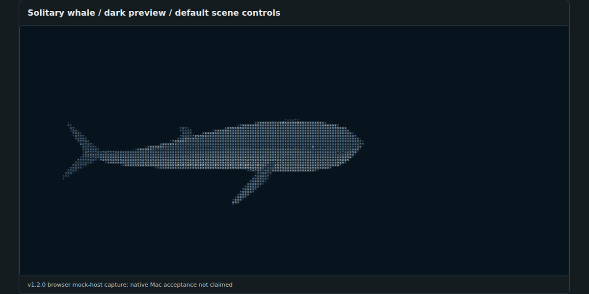
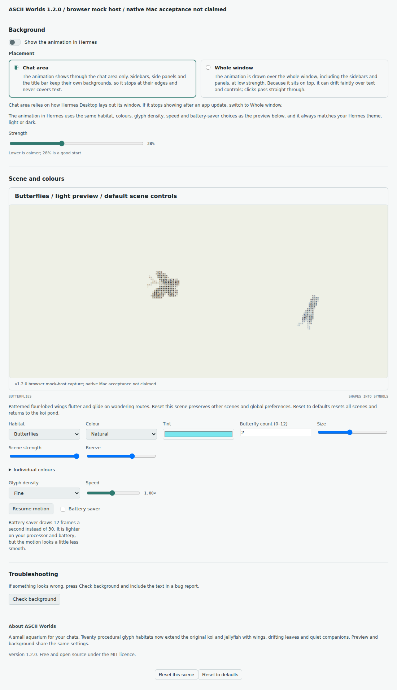

# ASCII Worlds

Twenty quiet, procedural glyph habitats for Hermes Desktop. Koi and jellyfish,
sea turtles and moths, a sleeping cat, drifting petals, a slowly changing sky.
Every creature is drawn from characters, not a video or downloaded image.



**Version 1.2.0.** The images on this page are **v1.2.0 browser mock-host captures,
not Mac screenshots**. The author hand-tested the full 1.2.0 plugin in Hermes Desktop
on a Mac and reports that everything worked; it was a general hand test with no
recorded checklist results. The Whole-window-only catalog build is the same plugin
without its second window-placement option; automated tests, browser captures and the
Hermes validator cover it, but the hand test did not. See the
[verification scope](docs/INTEGRATION-VERIFICATION.md).

## Start here

1. Use the reviewed `desktop/plugin.js` from this repository, or an explicitly
   versioned asset from [Releases](https://github.com/dudicslevente/hermes-ascii-worlds/releases).
   A source push does not create a release ZIP.
2. In the Desktop app's plugin-management page, **reveal the actual plugin folder**.
   Install on the computer running Desktop, not a remote gateway. Desktop plugins
   are app-level across profiles and connections; switching profiles is not isolation.
3. Back up an existing installation, then place the file at
   `<revealed plugin folder>/ascii-worlds/plugin.js`. Follow [INSTALL.md](INSTALL.md)
   for guarded copy, backup and rollback commands.
4. Run **Reload desktop plugins** from the command palette and enable ASCII Worlds.
   Open **Settings -> Plugins -> ASCII Worlds** (plugin-management labels vary by app build).
5. Choose a Habitat. The preview works without enabling the optional background.

<!-- catalog: `hermes plugins install ascii-worlds` installs the maintainer-reviewed commit that the Hermes catalog entry currently pins. Check the version shown on the ASCII Worlds settings page, then reload desktop plugins. -->

Want to try the artwork first? Open [`demo.html`](demo.html) directly in a browser.
It works offline and is not Hermes Desktop. Building needs Node 20+, not `npm install`:

```sh
npm run verify
```

## All twenty habitats


[Open the full dark/light gallery](docs/GALLERY.md). These are stills, not proof of smooth motion or native integration.

| Habitat | Default / maximum | Character |
| --- | ---: | --- |
| Koi pond | 3 / 10 | Patterned bodies, travelling tail waves |
| Jellyfish drift | 5 / 10 | Pulsing bells and trailing strands |
| Manta rays | 1 / 6 | Gliding turns, rippling fins |
| Sea turtles | 2 / 6 | Shells and alternating flippers |
| Seahorses | 3 / 8 | Upright drift and curled tails |
| Tiny fish school | 12 / 40 | Cohesion and individually phased strokes |
| Solitary whale | 1 / 3 | Broad crossings, including a deliberate offstage wait |
| Octopus | 2 / 4 | Independently curling arms |
| Butterflies | 2 / 12 | Hinged patterned wings |
| Luna moths | 1 / 8 | Eyespots and long hindwing tails |
| Dragonflies | 3 / 8 | Hover, glide and wing blur |
| Swallows | 3 / 10 | Flap/glide cycles and forked tails |
| Sleeping cat | 1 / 4 | A placed, breathing companion; no roaming |
| Owl | 1 / 3 | A placed companion with an optional perch |
| Ginkgo leaves | 14 / 60 | Tumbling fans |
| Cherry blossom petals | 18 / 80 | Flutter and shared gusts |
| Fireflies | 9 / 40 | Independent glow cycles |
| Bubbles | 12 / 40 | Rising, wobbling rings |
| Dandelion seeds | 8 / 24 | Tilting stalks and fine parachutes |
| Night sky | 80 / 220 | Fixed twinkling stars and optional meteors |

## Make it yours

- **Independent scene preferences:** counts, colours and applicable controls return
  when you revisit a habitat. Count includes zero. New habitats add Size and Scene strength.
- **Colour:** named palettes, Custom tint, and ten retained Individual slots where
  meaningful. Counts above ten repeat slots; Night sky deliberately has no Individual mode.
- **Motion:** Speed, or Pace for stationary/local motion, plus appropriate current,
  breeze or wind and scene-specific extras. Fine / Balanced / Bold glyph density.
- **Automatic theme:** preview and background follow Hermes, with OS fallback.
  There is no appearance picker.
- **Pause and Battery saver:** nominal frame caps are 30 fps or 12 fps, not guaranteed
  achieved rates or measured battery savings. Hidden windows suspend; offscreen previews stop.
- **Reduced motion:** starts still. Explicit Resume opts both canvases into motion
  for this plugin session; closing Settings keeps consent, a new OS hold/reload revokes it.
- **Reset this scene** affects only the selected habitat. **Reset to defaults** resets
  every scene and returns to Koi; neither resets background preferences or deletes old rollback records.

The [complete control matrix](docs/FEATURE-CONTROLS.md) lists ranges, palette exceptions,
extras and count-zero behaviour. [Migration and storage](docs/SETTINGS-MIGRATION.md)
explains v1/v2 -> v3, memory-only warnings and rollback.

## Optional animation in the window

Background is **off by default**. Toggle it in Settings, with the title-bar button,
or with **ASCII Worlds: toggle background** in the palette. **ASCII Worlds: open
settings** navigates to the form when the host provides the required SDK exports.
The background shares the preview's scene settings; its separate Strength is 8–60%
(default 28%). Clicks pass through, but a visible overlay can still affect readability.

<!-- chat-area:begin -->
The full distribution offers **Whole window** (transparent glyphs above all app
content) and **Chat area** (a layout-sensitive layer revealed through the chat).
The catalog build offers Whole window only.
<!-- chat-area:end -->
<!-- catalog: This catalog build offers **Whole window only**: transparent glyphs above app content, with no placement selector and no host-background restyling. -->

<!-- chat-area:begin -->
Chat area temporarily clears wrapper backgrounds and uses internal theme colours.
It is not a supported catalog surface; if a Desktop update hides it, switch to Whole window.
<!-- chat-area:end -->

<!-- chat-area:begin -->


Full distribution settings, captured from the actual generated plugin under real React and a mock SDK.
<!-- chat-area:end -->
<!-- catalog: 

Actual catalog-build settings. No unsupported placement choice is shown. -->


This is a deliberately generic browser mock workspace, **not a fabricated Hermes
app screenshot**. The browser composites the actual plugin layer at its real opacity.

## Privacy, resources and limits

- No runtime network calls, telemetry, accounts, credentials, shell commands,
  external art/fonts or downloaded code. Preferences use plugin-namespaced local storage.
  Conversation text is never read or sent by the plugin. Optional test tooling is separate.
- One active renderer per visible canvas: the preview and, if enabled, one window layer.
  Bounded canvas/grid allocations and scene caps limit work, not CPU or battery guarantees.
- **Check background** is an explicit local diagnostic of build/layer/canvas/style geometry.
  Review diagnostic text and screenshots before sharing them; they can identify host layout.
<!-- chat-area:begin -->
  In the full distribution it also inspects the chat wrapper chain, without reading message text.
<!-- chat-area:end -->
- High counts or large sizes can overlap. Small/Bold output simplifies thin features;
  light Cat/Owl faces, pale light-theme seeds, fish and swallows, and quiet halos/stars
  are lower-contrast. The whale intentionally leaves the frame.
- Declared Hermes floor: **>=0.21.6**. The author hand-tested the full 1.2.0 plugin on a
  Mac with Hermes Desktop (a general test; no Desktop version or per-item results were
  recorded); the catalog build was not hand-tested. Windows and Linux Desktop, Safari,
  physical phones, other Hermes versions, accessibility, heat and battery use are untested.
- Desktop plugins execute with the renderer's authority; error isolation is not a security sandbox.
<!-- chat-area:begin -->
  The full distribution's Chat area additionally depends on host markup; that behaviour is stripped from catalog code and documentation.
<!-- chat-area:end -->

## Documentation and contributing

[Install / rollback](INSTALL.md) · [Gallery](docs/GALLERY.md) ·
[Controls](docs/FEATURE-CONTROLS.md) · [Background internals](docs/HOW-BACKGROUND-WORKS.md) ·
[Architecture](docs/ARCHITECTURE.md) · [Development / testing](docs/DEVELOPMENT.md) ·
[Compatibility](docs/COMPATIBILITY.md) · [Manual Mac checklist](docs/MANUAL-MAC-CHECKLIST.md) ·
[Catalog disclosures](docs/CATALOG.md) · [Changelog](CHANGELOG.md) · [Contributing](CONTRIBUTING.md)

MIT. Original koi/jellyfish artwork and approved Lab scene modules are retained.
[Third-party notices](THIRD_PARTY_NOTICES.md) document provenance and visual references.
[Historical v1.1 images](docs/HISTORY.md) are labelled separately and are not new Mac testing.
