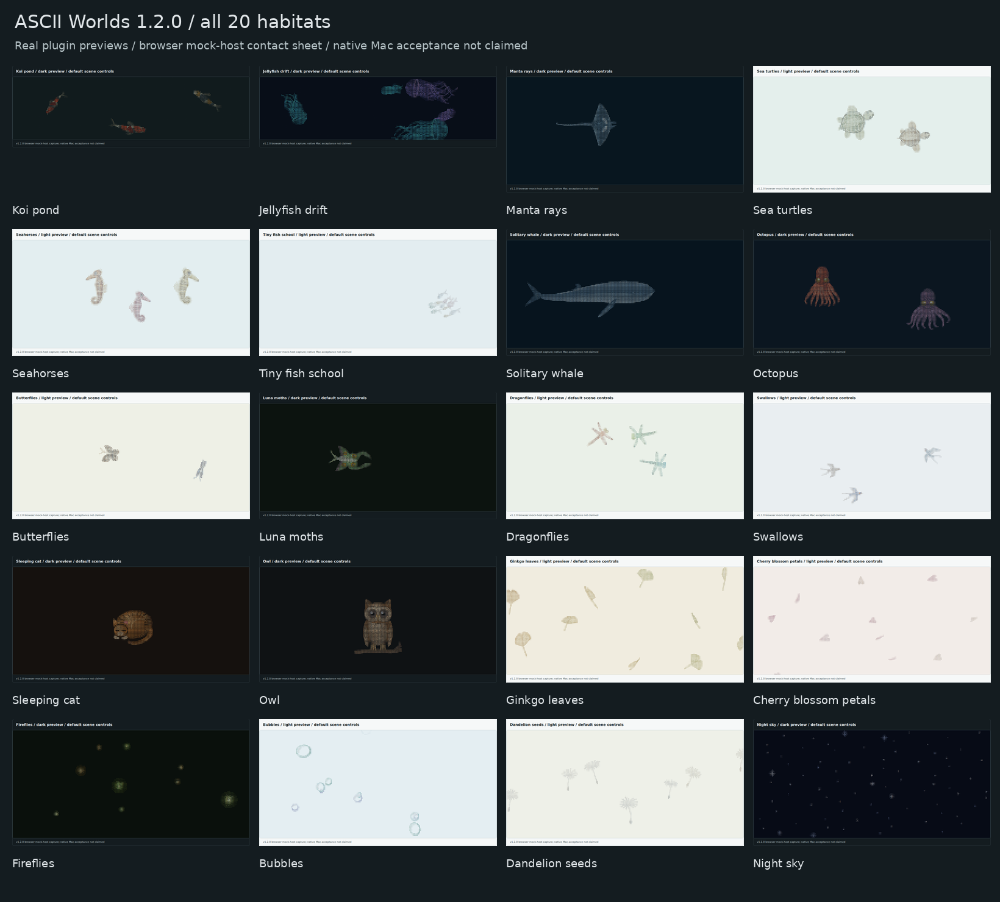
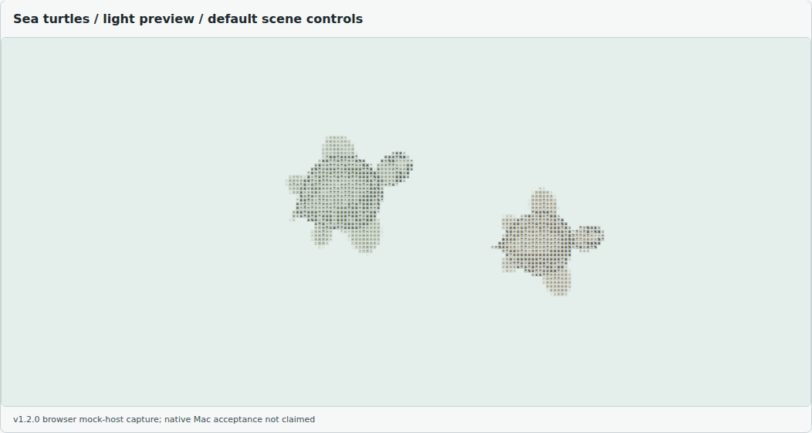
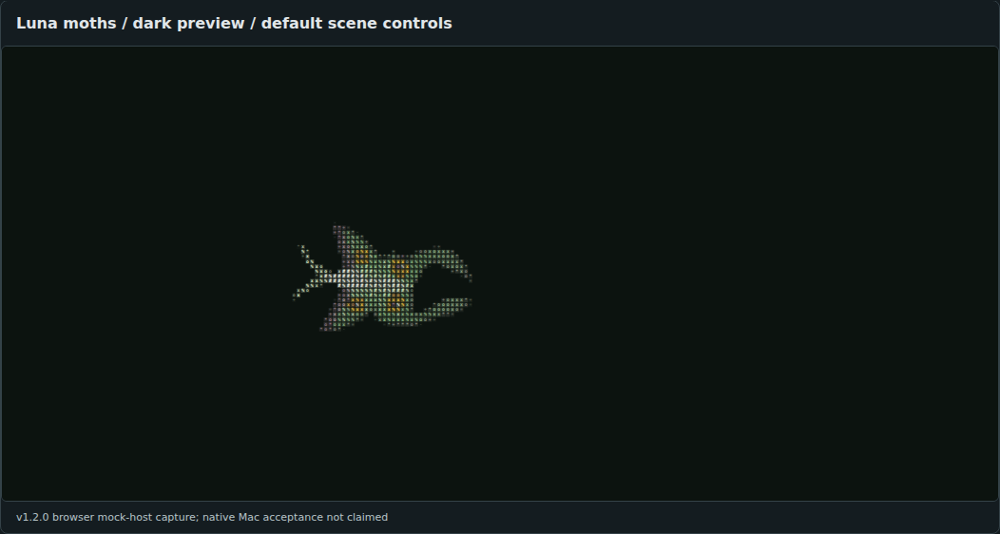
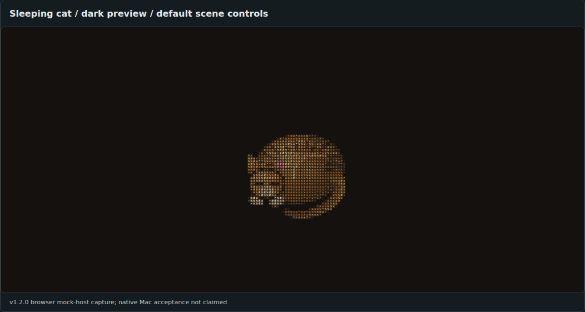
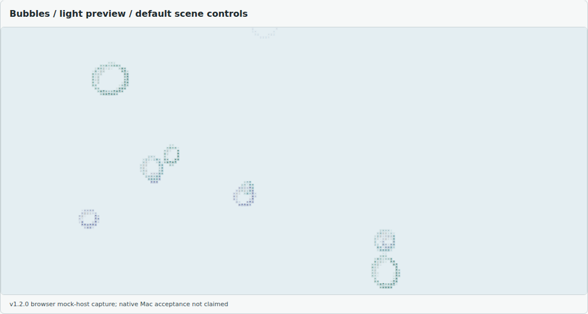
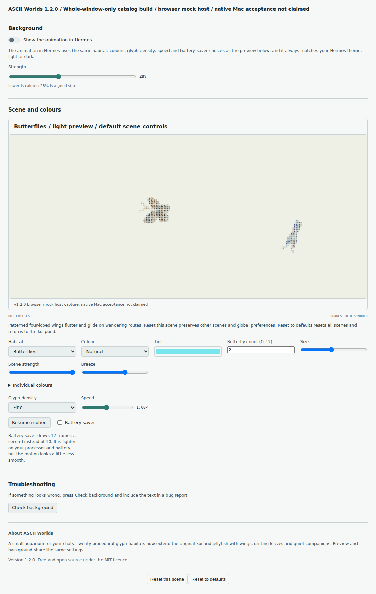
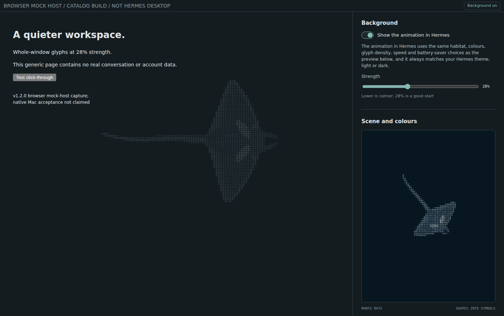

# Screenshot gallery — ASCII Worlds 1.2.0

**Every current image below is a v1.2.0 browser mock-host capture, not a Mac
screenshot.** The captions say "native Mac acceptance not claimed" because a
mock-host image cannot show it; the author's separate hand test is in
[STATUS](../STATUS.md). The real generated `desktop/plugin.js` is registered
with a mock SDK and rendered through **real React Strict Mode in Linux Chromium**.
Nothing here is a live Desktop Preview, an invented app screenshot, or an old Lab
render passed off as this plugin.

The scene frames use default scene controls, paused at their initial composition.
Light/dark is supplied by the mock host's theme tokens, not a plugin theme picker.
Labels identify the capture environment. The overview is a labelled contact sheet
of these real frames; the 2:1 banner is a letterboxed real whale frame. Neither
adds invented creatures. Stills establish appearance, not animation smoothness.

## A closer look

Sea turtles, light theme. Two default subjects; no size or population tuning for the image.

Luna moths, dark theme. A sparse default composition preserves the character texture.

Sleeping cat, dark theme. It stays placed; Pace affects local gestures, not roaming.
Small/light facial details remain coarse and lower-contrast.

Bubbles, light theme. Default outlined rings; ambient scenes deliberately have quieter contrast.

## Every habitat, in both themes

Open any frame at full size. All forty are captured from the current generated
plugin, not its standalone demo. Names and exact IDs match the native selector.

| Habitat / exact ID | Dark frame | Light frame |
| --- | --- | --- |
| Koi pond / `koi` | [Dark](images/v1.2/koi-dark.png) | [Light](images/v1.2/koi-light.png) |
| Jellyfish drift / `jellyfish` | [Dark](images/v1.2/jellyfish-dark.png) | [Light](images/v1.2/jellyfish-light.png) |
| Manta rays / `manta-rays` | [Dark](images/v1.2/manta-rays-dark.png) | [Light](images/v1.2/manta-rays-light.png) |
| Sea turtles / `sea-turtles` | [Dark](images/v1.2/sea-turtles-dark.png) | [Light](images/v1.2/sea-turtles-light.png) |
| Seahorses / `seahorses` | [Dark](images/v1.2/seahorses-dark.png) | [Light](images/v1.2/seahorses-light.png) |
| Tiny fish school / `tiny-fish-school` | [Dark](images/v1.2/tiny-fish-school-dark.png) | [Light](images/v1.2/tiny-fish-school-light.png) |
| Solitary whale / `solitary-whale` | [Dark](images/v1.2/solitary-whale-dark.png) | [Light](images/v1.2/solitary-whale-light.png) |
| Octopus / `octopus` | [Dark](images/v1.2/octopus-dark.png) | [Light](images/v1.2/octopus-light.png) |
| Butterflies / `butterflies` | [Dark](images/v1.2/butterflies-dark.png) | [Light](images/v1.2/butterflies-light.png) |
| Luna moths / `luna-moths` | [Dark](images/v1.2/luna-moths-dark.png) | [Light](images/v1.2/luna-moths-light.png) |
| Dragonflies / `dragonflies` | [Dark](images/v1.2/dragonflies-dark.png) | [Light](images/v1.2/dragonflies-light.png) |
| Swallows / `swallows` | [Dark](images/v1.2/swallows-dark.png) | [Light](images/v1.2/swallows-light.png) |
| Sleeping cat / `sleeping-cat` | [Dark](images/v1.2/sleeping-cat-dark.png) | [Light](images/v1.2/sleeping-cat-light.png) |
| Owl / `owl` | [Dark](images/v1.2/owl-dark.png) | [Light](images/v1.2/owl-light.png) |
| Ginkgo leaves / `ginkgo-leaves` | [Dark](images/v1.2/ginkgo-leaves-dark.png) | [Light](images/v1.2/ginkgo-leaves-light.png) |
| Cherry blossom petals / `cherry-blossom-petals` | [Dark](images/v1.2/cherry-blossom-petals-dark.png) | [Light](images/v1.2/cherry-blossom-petals-light.png) |
| Fireflies / `fireflies` | [Dark](images/v1.2/fireflies-dark.png) | [Light](images/v1.2/fireflies-light.png) |
| Bubbles / `bubbles` | [Dark](images/v1.2/bubbles-dark.png) | [Light](images/v1.2/bubbles-light.png) |
| Dandelion seeds / `dandelion-seeds` | [Dark](images/v1.2/dandelion-seeds-dark.png) | [Light](images/v1.2/dandelion-seeds-light.png) |
| Night sky / `night-sky` | [Dark](images/v1.2/night-sky-dark.png) | [Light](images/v1.2/night-sky-light.png) |

## Actual Settings and composited background

Catalog form, captured from a **separately generated catalog plugin**, without a
placement selector. This is the appropriate settings image for a catalog listing.

Actual browser compositing at 28%. The fixture contains generic explanatory text,
no real conversation, session titles, sidebar or machine/account information.
Click-through was exercised during capture. It is a mock host, not Hermes UI artwork.

## Capture provenance and reuse

- [Capture manifest](images/v1.2/captures.json): exact plugin/catalog SHA-256,
  scene/tone/settings and byte hashes of actual screenshots.
- [Image manifest](images/v1.2/gallery.json): captions, dimensions, byte sizes and
  SHA-256 for every current PNG, including the contact sheet and banner.
- [Reproduce the gallery](DEVELOPMENT.md#refresh-the-gallery): optional docs tooling,
  no live app install or remote requests. Font rasterization can vary by platform.
- [Historical v1.1 images](HISTORY.md): separate, explicitly historical crops.

The catalog schema allows a 2:1 banner and **up to six** gallery images. The
recommended catalog-safe set is `overview.png`, `sea-turtles-light.png`,
`luna-moths-dark.png`, `sleeping-cat-dark.png`, `settings-catalog.png`, and
`whole-window-catalog.png`, all under `docs/images/v1.2/`. Pin their raw GitHub URLs
to the same full commit as the catalog entry, never a moving branch.
