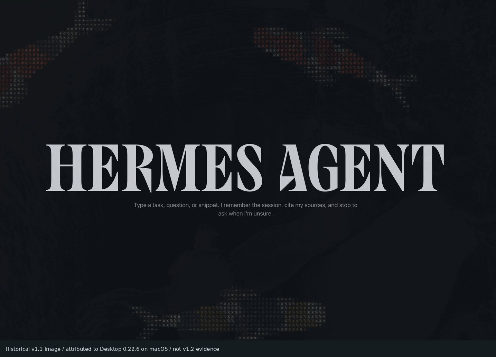
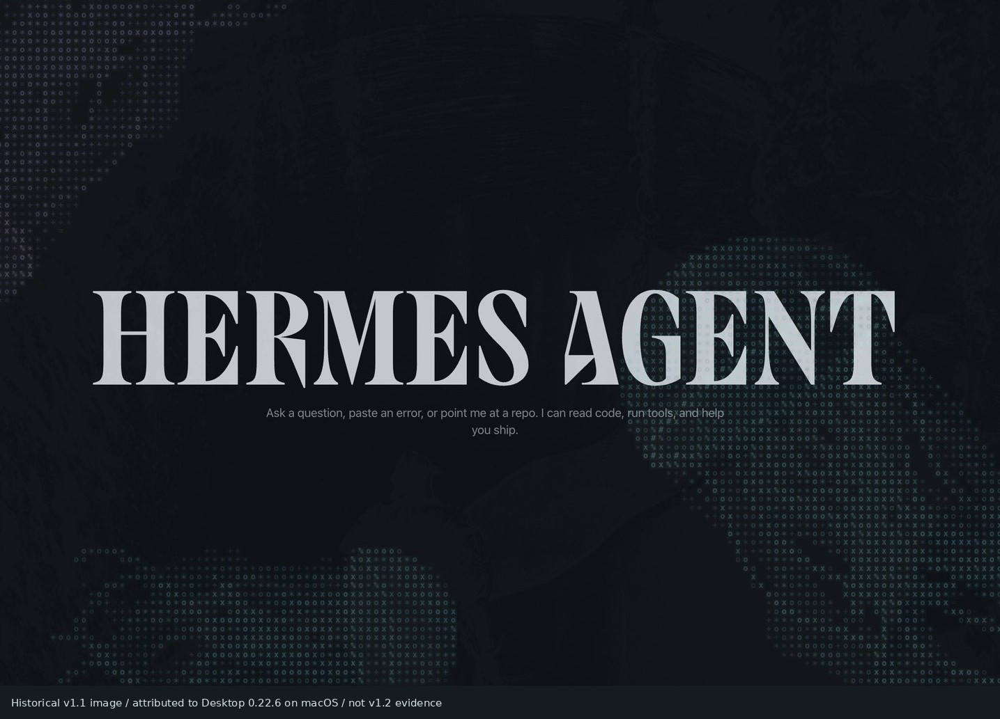
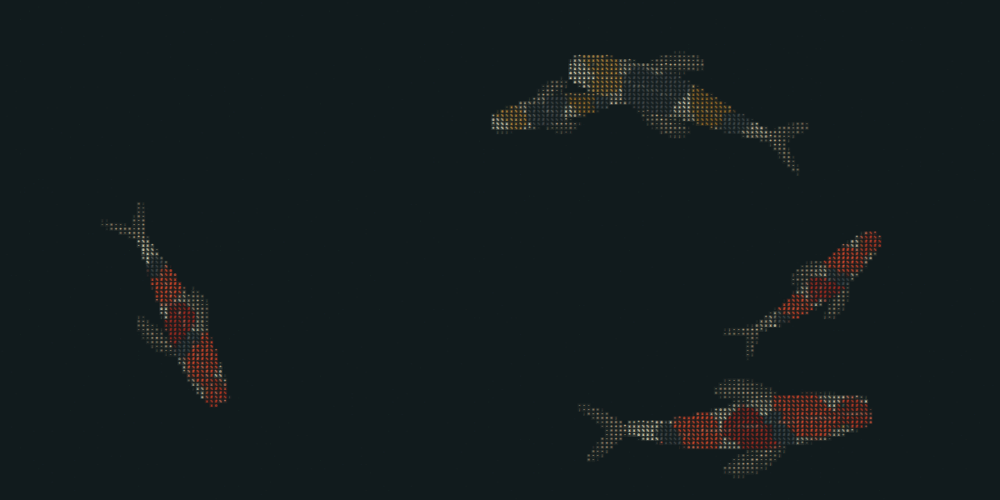

# Historical images and storyboard

These are **historical v1.1 images**, attributed by the original project records
to Hermes Desktop 0.22.6 on macOS. That attribution is not newly verified native
acceptance, and these pictures are **not evidence for v1.2.0**. Current browser
captures and their limitations are in the [1.2.0 gallery](GALLERY.md).

The two public welcome-screen crops omit sidebars, user/account controls, model
selectors and machine information. Their original pixels are not used to create
new version screenshots. The v1.2.0 tree no longer carries the earlier full-window
v1.1 screenshots, but they remain visible in earlier commits and tags and at the
immutable commit URLs that older catalog pins used.

Historical koi image. This is not a newly performed Mac test.

Historical jellyfish image. It does not establish current host compatibility.

The original 1200x600 koi banner is retained as historical art, not a current capture.

The approved [demo-video storyboard](DEMO-VIDEO-SCRIPT.md) remains **verbatim**.
It is a saved production direction, not proof that the film was recorded or that a
1.2.0 catalog listing exists. Its original
koi/jellyfish scope must be distinguished from the twenty-habitat implementation.
